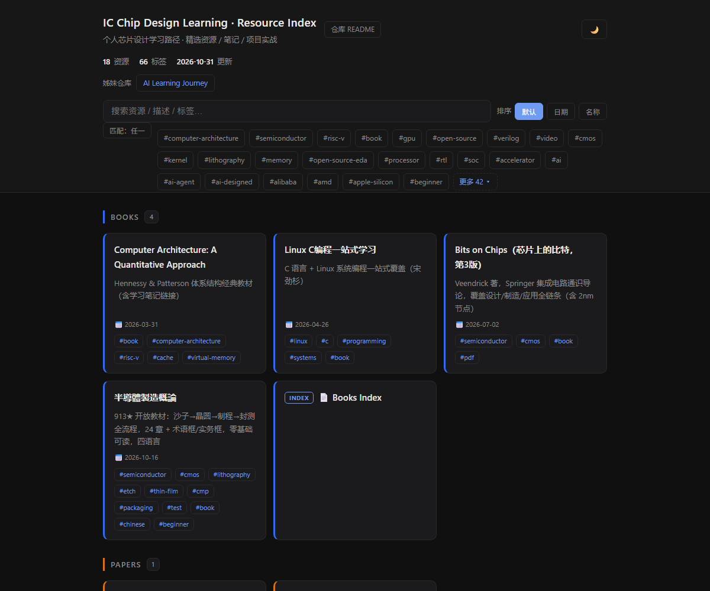
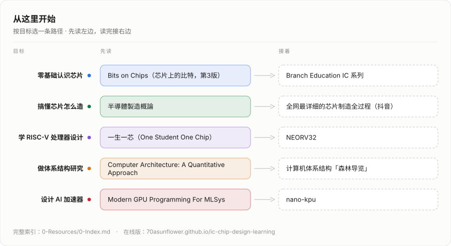

<h1 align="center">IC Chip Design Learning</h1>

<p align="center">
  从 RTL 到流片 · 精选资源 / 笔记 / 代码 / 项目<br>
  <sub>每条资源都带中文摘要与要点，点开即可在线阅读</sub>
</p>

<p align="center">
  <a href="https://70asunflower.github.io/ic-chip-design-learning/"><b>🌐 在线索引</b></a>
  &nbsp;·&nbsp;
  <a href="0-Resources/0-Index.md">📚 全部资源</a>
  &nbsp;·&nbsp;
  <a href="CONTRIBUTING.md">🛠 参与维护</a>
  &nbsp;·&nbsp;
  <a href="https://70asunflower.github.io/ai-learning-journey/">🤖 AI Learning Journey</a>
</p>

<p align="center">
  <a href="https://70asunflower.github.io/ic-chip-design-learning/">
    
  </a>
</p>

## ✨ 从这里开始

<p align="center">
  <a href="https://70asunflower.github.io/ic-chip-design-learning/">
    <picture>
      <source media="(prefers-color-scheme: dark)" srcset="assets/roadmap-dark.svg">
      
    </picture>
  </a>
</p>

<details>
<summary>文本版（可点击跳转）</summary>

<!-- BUILD:MAP:START -->
**1. 认识芯片**

- [Bits on Chips（芯片上的比特，第3版）](0-Resources/1-Books/bits-on-chips-veendrick.md) — Veendrick 著，Springer 集成电路通识导论，覆盖设计/制造/应用全链条（含 2nm 节点）
- [Branch Education IC 系列](0-Resources/5-Courses-Tutorials/branch-education-ic-series.md) — 3D 动画科普：光刻→芯片制造→CPU 架构
- [HBM 原理详解（抖音）](0-Resources/7-Videos/hbm-principles-douyin.md) — Redknot-乔红：HBM 高带宽存储器原理动画讲解

**2. 制造与工艺**

- [半導體製造概論](0-Resources/1-Books/semiconductor-manufacturing-introduction.md) — 913★ 开放教材：沙子→晶圆→制程→封测全流程，24 章 + 术语框/实务框，零基础可读，四语言
- [全网最详细的芯片制造全过程（抖音）](0-Resources/7-Videos/chip-manufacturing-process-douyin.md) — 大黄视界频道：从硅片到成品芯片的完整制造流程
- [光通信器件原理：从能级跃迁到硅光芯片](0-Resources/5-Courses-Tutorials/optical-communication-device-principles.md) — 光通信入门科普：调制器/激光器/探测器，连接 IC 制造与光子学

**3. 体系结构**

- [Computer Architecture: A Quantitative Approach](0-Resources/1-Books/computer-architecture-quantitative-approach.md) — Hennessy & Patterson 体系结构经典教材（含学习笔记链接）
- [计算机体系结构「森林导览」](0-Resources/2-Papers/computer-architecture-forest-guide.md) — 87页研一综述：从通用处理器到 LLM/Tansformer 加速、Chiplet、神经形态/量子/光子，附PDF

**4. 处理器设计**

- [一生一芯（One Student One Chip）](0-Resources/5-Courses-Tutorials/ysyx-one-student-one-chip.md) — 中科院计算所 RISC-V 处理器芯片全流程设计培养计划，免费流片
- [RISC-V Vector Primer (RVV 1.0 指南)](0-Resources/5-Courses-Tutorials/riscv-vector-primer.md) — 面向架构师/编译器/边缘 AI 开发者的 RVV 实践指南，延伸 Matrix Extension
- [NEORV32](0-Resources/4-OpenSource-Projects/neorv32.md) — 纯 VHDL RISC-V SoC，支持 6 大 FPGA 厂商 + ASIC 流片
- [XUANTIE-RV 玄铁](0-Resources/4-OpenSource-Projects/xuantie-rv.md) — 达摩院 RISC-V 开源生态，OpenC910/C906/E906 + wujian100 SoC

**5. AI 芯片与 GPU**

- [CUDA Programming Guide](0-Resources/5-Courses-Tutorials/cuda-programming-guide.md) — NVIDIA 官方 GPU 并行编程模型文档
- [Modern GPU Programming For MLSys](0-Resources/5-Courses-Tutorials/mlc-modern-gpu-programming.md) — MLC.ai/CMU 出品：Blackwell GPU Kernel 实战（TMA/Warp Spec/FlashAttention 4）
- [nano-kpu](0-Resources/4-OpenSource-Projects/nano-kpu.md) — MoonshotAI：Kimi-K3 全流程设计的推理芯片 RTL（KDA 线性注意力 + MLA + MoE，int4），带完整仿真与综合流程

**6. 验证与工具**

- [wave-mcp](0-Resources/3-EDA-Tools/wave-mcp.md) — 腾讯开源波形调试 MCP：只读波形 + RTL，给 AI Agent 37 个工具（值/X 态追踪、pass/fail diff、浏览器波形），免 License
- [HiEq · Layout 裸片图库](0-Resources/4-OpenSource-Projects/hieq-dieshot-gallery.md) — 222 张处理器 die shot（25 家厂商、标注工艺节点），在线浏览与原图下载

**7. 周边知识**

- [Linux C编程一站式学习](0-Resources/1-Books/linux-c-programming.md) — C 语言 + Linux 系统编程一站式覆盖（宋劲杉）
<!-- BUILD:MAP:END -->

</details>

## 🗂️ 资源导航

<!-- BUILD:NAV:START -->
<details open>
<summary><b>📚 Resources</b></summary>

<details>
<summary>1-Books</summary>

- [Computer Architecture: A Quantitative Approach](0-Resources/1-Books/computer-architecture-quantitative-approach.md) — Hennessy & Patterson 体系结构经典教材（含学习笔记链接）
- [Linux C编程一站式学习](0-Resources/1-Books/linux-c-programming.md) — C 语言 + Linux 系统编程一站式覆盖（宋劲杉）
- [Bits on Chips（芯片上的比特，第3版）](0-Resources/1-Books/bits-on-chips-veendrick.md) — Veendrick 著，Springer 集成电路通识导论，覆盖设计/制造/应用全链条（含 2nm 节点）
- [半導體製造概論](0-Resources/1-Books/semiconductor-manufacturing-introduction.md) — 913★ 开放教材：沙子→晶圆→制程→封测全流程，24 章 + 术语框/实务框，零基础可读，四语言
- [📄 Books Index](0-Resources/1-Books/README.md)

</details>

<details>
<summary>2-Papers</summary>

- [计算机体系结构「森林导览」](0-Resources/2-Papers/computer-architecture-forest-guide.md) — 87页研一综述：从通用处理器到 LLM/Tansformer 加速、Chiplet、神经形态/量子/光子，附PDF
- [📄 Papers Index](0-Resources/2-Papers/README.md)

</details>

<details>
<summary>3-EDA Tools</summary>

- [wave-mcp](0-Resources/3-EDA-Tools/wave-mcp.md) — 腾讯开源波形调试 MCP：只读波形 + RTL，给 AI Agent 37 个工具（值/X 态追踪、pass/fail diff、浏览器波形），免 License
- [📄 EDA Tools Index](0-Resources/3-EDA-Tools/README.md)

</details>

<details>
<summary>4-Open Source Projects</summary>

- [NEORV32](0-Resources/4-OpenSource-Projects/neorv32.md) — 纯 VHDL RISC-V SoC，支持 6 大 FPGA 厂商 + ASIC 流片
- [XUANTIE-RV 玄铁](0-Resources/4-OpenSource-Projects/xuantie-rv.md) — 达摩院 RISC-V 开源生态，OpenC910/C906/E906 + wujian100 SoC
- [nano-kpu](0-Resources/4-OpenSource-Projects/nano-kpu.md) — MoonshotAI：Kimi-K3 全流程设计的推理芯片 RTL（KDA 线性注意力 + MLA + MoE，int4），带完整仿真与综合流程
- [HiEq · Layout 裸片图库](0-Resources/4-OpenSource-Projects/hieq-dieshot-gallery.md) — 222 张处理器 die shot（25 家厂商、标注工艺节点），在线浏览与原图下载
- [📄 Open Source Projects Index](0-Resources/4-OpenSource-Projects/README.md)

</details>

<details>
<summary>5-Courses & Tutorials</summary>

- [CUDA Programming Guide](0-Resources/5-Courses-Tutorials/cuda-programming-guide.md) — NVIDIA 官方 GPU 并行编程模型文档
- [光通信器件原理：从能级跃迁到硅光芯片](0-Resources/5-Courses-Tutorials/optical-communication-device-principles.md) — 光通信入门科普：调制器/激光器/探测器，连接 IC 制造与光子学
- [Modern GPU Programming For MLSys](0-Resources/5-Courses-Tutorials/mlc-modern-gpu-programming.md) — MLC.ai/CMU 出品：Blackwell GPU Kernel 实战（TMA/Warp Spec/FlashAttention 4）
- [Branch Education IC 系列](0-Resources/5-Courses-Tutorials/branch-education-ic-series.md) — 3D 动画科普：光刻→芯片制造→CPU 架构
- [一生一芯（One Student One Chip）](0-Resources/5-Courses-Tutorials/ysyx-one-student-one-chip.md) — 中科院计算所 RISC-V 处理器芯片全流程设计培养计划，免费流片
- [RISC-V Vector Primer (RVV 1.0 指南)](0-Resources/5-Courses-Tutorials/riscv-vector-primer.md) — 面向架构师/编译器/边缘 AI 开发者的 RVV 实践指南，延伸 Matrix Extension
- [📄 Courses & Tutorials Index](0-Resources/5-Courses-Tutorials/README.md)

</details>

<details>
<summary>6-Industry Standards</summary>

- [📄 Industry Standards Index](0-Resources/6-Industry-Standards/README.md)

</details>

<details>
<summary>7-Videos</summary>

- [全网最详细的芯片制造全过程（抖音）](0-Resources/7-Videos/chip-manufacturing-process-douyin.md) — 大黄视界频道：从硅片到成品芯片的完整制造流程
- [HBM 原理详解（抖音）](0-Resources/7-Videos/hbm-principles-douyin.md) — Redknot-乔红：HBM 高带宽存储器原理动画讲解
- [📄 Videos Index](0-Resources/7-Videos/README.md)

</details>

- [📋 Full Resource Index](0-Resources/0-Index.md)

</details>
<!-- BUILD:NAV:END -->

<details open>
<summary><b>📝 Personal Notes</b></summary>

<details>
<summary>1-Digital-Design</summary>

- [CA: Quantitative Approach 学习笔记](1-Notes/1-Digital-Design/ca-quantitative-approach-notes.md) — 计算机体系结构 Cache/Memory Hierarchy 笔记（持续更新）

</details>

<details>
<summary>2-Analog-Design</summary>

_Empty — add your first analog design note!_

</details>

<details>
<summary>3-Verification</summary>

_Empty — add your first verification note!_

</details>

<details>
<summary>4-Physical-Design</summary>

_Empty — add your first physical design note!_

</details>

<details>
<summary>5-DFT</summary>

_Empty — add your first DFT note!_

</details>

<details>
<summary>6-PDK-Process</summary>

_Empty — add your first PDK/process note!_

</details>

[📋 Note Template](1-Notes/0-Template.md)

</details>

<details>
<summary><b>💻 Code & Projects</b></summary>

<details>
<summary><a href="2-Code/README.md">Code Examples</a></summary>

<details>
<summary>rtl-examples</summary>

_Empty — add an RTL example!_

</details>

<details>
<summary>uvm-testbench</summary>

_Empty — add a UVM testbench!_

</details>

<details>
<summary>tcl-scripts</summary>

_Empty — add a TCL script!_

</details>

<details>
<summary>python-tools</summary>

_Empty — add a Python tool!_

</details>

<details>
<summary>openroad-flows</summary>

_Empty — add an OpenROAD flow!_

</details>

</details>

<details open>
<summary><a href="3-Projects/README.md">Projects</a></summary>

<details>
<summary>riscv-core</summary>

_Empty — start the RISC-V core project!_

</details>

<details>
<summary>accelerator</summary>

_Empty — start the accelerator project!_

</details>

<details>
<summary>mixed-signal-soc</summary>

_Empty — start the mixed-signal SoC project!_

</details>

<details>
<summary>tapeout-prep</summary>

_Empty — start the tapeout prep project!_

</details>

</details>

</details>

---

## Directory Structure

```
ic-chip-design-learning/
├── 0-Resources/              # External resources
│   ├── 0-Index.md            # Full resource index
│   ├── 1-Books/              # IC design textbooks & references
│   ├── 2-Papers/             # Research papers
│   ├── 3-EDA-Tools/          # EDA tool notes (Synopsys, Cadence, Si2, etc.)
│   ├── 4-OpenSource-Projects/# Open-source chip projects
│   ├── 5-Courses-Tutorials/  # Online courses & tutorials
│   ├── 6-Industry-Standards/ # AMBA, UCIe, JEDEC, etc.
│   └── 7-Videos/             # Video explainers (Douyin/YouTube/etc.)
├── 1-Notes/                  # Personal study notes
│   ├── 1-Digital-Design/    # Combinational/sequential, HDL, microarchitecture
│   ├── 2-Analog-Design/     # Amplifiers, PLLs, ADCs/DACs, layout
│   ├── 3-Verification/      # UVM, formal verification, coverage
│   ├── 4-Physical-Design/   # Synthesis, PnR, STA, signoff
│   ├── 5-DFT/               # Scan, BIST, JTAG, ATPG
│   └── 6-PDK-Process/       # Process nodes, PDKs, DRC/LVS
├── 2-Code/                   # Runnable code & scripts
│   ├── rtl-examples/        # Verilog/SystemVerilog RTL examples
│   ├── uvm-testbench/       # UVM testbench components
│   ├── tcl-scripts/         # EDA TCL scripts (DC, ICC2, Innovus)
│   ├── python-tools/        # Python utilities for chip design
│   └── openroad-flows/      # OpenROAD ASIC flow scripts
├── 3-Projects/               # Comprehensive projects
│   ├── riscv-core/          # RISC-V CPU core implementation
│   ├── accelerator/         # Domain-specific accelerator design
│   ├── mixed-signal-soc/    # Mixed-signal SoC project
│   └── tapeout-prep/        # Tapeout preparation checklist & GDS
├── assets/                   # README preview + roadmap SVGs (generated)
├── scripts/                  # build.py / check_consistency.py / normalize_tags.py
├── CONTRIBUTING.md           # How to add a resource / note / code example
└── README.md
```

## 🤝 参与维护

新增资源只需要写**一个** `.md` 文件——`0-Index.md`、子目录表格、上面这份导航和
网页索引全部由 `python scripts/build.py` 从 frontmatter 生成。

完整流程与硬性规则见 [CONTRIBUTING.md](CONTRIBUTING.md)。

## Changelog

<details>
<summary>展开完整更新日志</summary>

| Date       | Content                                       |
|------------|-----------------------------------------------|
| 2026-10-31 | Added wave-mcp — 腾讯开源波形调试 MCP Server（37 工具 / FST 直读 / X 态追踪 / pass-fail diff），填补 3-EDA-Tools 分类 |
| 2026-10-16 | Added 半導體製造概論 — chenwei810 913★ 制造全流程开放教材（24 章 + 术语/实务框，四语言） |
| 2026-09-27 | Added HiEq · Layout 裸片图库 — 222 张处理器 die shot（25 家厂商、标注工艺节点），在线浏览与原图下载 |
| 2026-09-16 | Added nano-kpu — MoonshotAI/Kimi-K3 设计的推理芯片 RTL（KDA 线性注意力 + NoPE MLA + sigmoid MoE，int4），含 Verilator/yosys/Nangate45 流程 |
| 2026-08-23 | Added RISC-V Vector Primer (RVV 1.0 指南) — 架构师/编译器/边缘 AI 开发者向 RVV 实践指南，含 Matrix Extension |
| 2026-08-01 | Added 7-Videos category: HBM 原理详解 / 芯片制造全过程（抖音视频笔记） |
| 2026-07-28 | Added 一生一芯（One Student One Chip）— 中科院计算所 RISC-V 处理器芯片全流程设计培养计划 |
| 2026-07-02 | Added Bits on Chips（芯片上的比特，第3版）— Veendrick 著，Springer 集成电路通识导论 |
| 2026-06-09 | Added 计算机体系结构「森林导览」— 87页综述，附PDF |
| 2026-06-05 | Added 光通信器件原理科普 — 从能级跃迁到硅光芯片 |
| 2026-05-29 | Added NEORV32 RISC-V SoC 开源项目 |
| 2026-05-29 | Added XUANTIE-RV 玄铁 RISC-V 开源生态 |
| 2026-04-26 | Added Linux C编程一站式学习 — C 语言 + Linux 系统编程 |
| 2026-04-22 | Added CA: Quantitative Approach 学习笔记 — Cache/Memory Hierarchy |
| 2026-04-03 | Added CUDA Programming Guide                  |
| 2026-03-31 | Repository init, directory structure, wiki nav|
| 2026-03-31 | Added note template                           |

</details>
